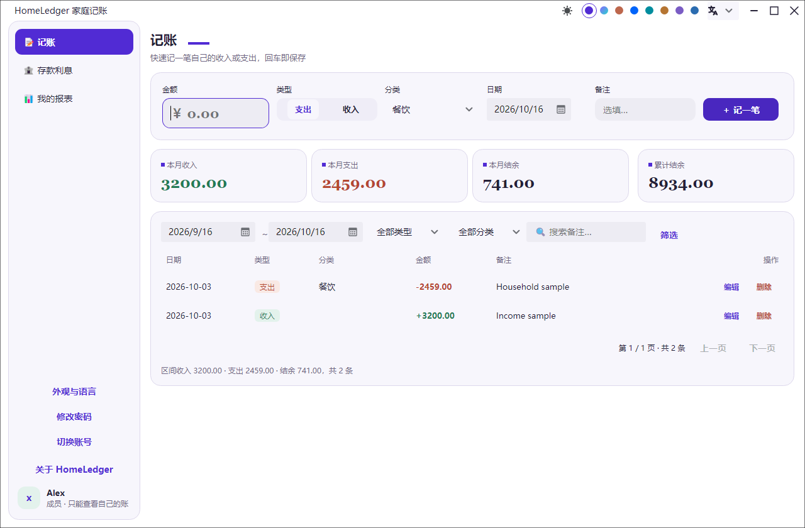

# HomeLedger 家庭记账

Avalonia 桌面家庭记账工具。多家庭成员独立账户、管理员全局汇总；自定义年利率的家庭存款计息（复利结转）；收支记账与图形化报表导出。个人自用，数据本地 SQLite 存储。

当前版本：**0.1.13**。



0.1.13 本地候选版本的 Windows NativeAOT 真实控件离屏截图，使用隔离的成员与交易样例。截图来源、源码指纹和 SHA-256 见[媒体复核记录](docs/recheck25-native-media.md)。本机验证记录不替代 GitHub Release 发布状态。

## 功能

- **账号体系**：管理员（只管理不记账）+ 家庭成员每人一账号；成员只能看到自己的账；PBKDF2 密码哈希；首次登录强制改密。
- **记账**：收入/支出、分类（内置 + 自定义）、备注、日期筛选与关键词搜索；按月汇总与累计结余。
- **存款利息**：存在父母处的钱，每笔可单独设年利率（默认 10%）；单利按日计息（365 天）；“结算”将应计利息结转本金实现复利；支持全额/部分支取（剩余本息按原利率续存）；结算历史可查。
- **全家总览（管理员）**：成员收支对比、月度趋势、分类占比、成员汇总明细（含存款本息）。
- **报表导出**：CSV / PNG（图表）/ PDF / Word 四格式，成员导出自己的、管理员导出全家（含存款利息）。
- **数据备份**：一键复制带时间戳的数据库副本。
- **外观与语言**：共享 StudioThemeController 的系统/浅色/深色模式，八套配色，简体中文/English；偏好自动保存。
- **关于与更新**：真实版本、构建时间、运行平台、作者、版权与仓库；复用 Toolkit 检查、下载、SHA-256 校验、安装与重试，缺少适配包时打开发布页。

## 使用

```bash
dotnet run --project src/HomeLedger.Desktop/HomeLedger.Desktop.csproj -f net10.0
```

首次启动自动建库并初始化管理员：**admin / admin123**（首次登录需修改密码）。管理员在“成员管理”中为家人创建账号（成员首次登录也会被要求改密）。

数据文件：存放在操作系统应用数据目录（Windows 为 `%LOCALAPPDATA%\HomeLedger\ledger.db`），不随安装目录走，也不入仓库；首次启动自动建库，旧版放在 exe 旁的数据库会自动迁移过来。

### 发布

```bash
publish_win-x64.bat
```

产出 NativeAOT 程序 `publish/win-x64/HomeLedger.Desktop.exe` 及其原生依赖、`I18n` 业务资源。分发使用安装包，不能只复制 exe。

## 利息规则

- 单利按日计息：`利息 = 本金 × 年利率% × 天数 ÷ 365`，四舍五入到分；起息日为存款日（或最近结转日）。
- 复利通过“结算结转”实现：结算生成一笔“原本金 + 应计利息”的新链末端并重新起息，历史留痕（利息链）。
- 部分支取：支取部分结清，剩余本息生成新存款按原利率继续计息。

## 技术栈

.NET 10 · Avalonia 12 · Semi.Avalonia · Ursa · CodeWF.Avalonia Controls/Lang 12.1.4.25 · Toolkit 1.0.0.19 · Prism.Core · SQLite + Dapper.AOT · QuestPDF · OpenXML · SkiaSharp

## 测试

```bash
dotnet test
```

覆盖利息计算、结转复利、部分支取、账号与数据隔离、报表组装、CSV 导出。

无桌面界面验证见 [验证说明](scripts/ui-verification/README.md)。发布后的原生程序可显式执行 `HomeLedger.Desktop --verify-runtime <独立临时目录>`；该入口只使用指定目录创建测试数据库，不打开应用窗口。

## 文档

- [需求文档](docs/HomeLedger家庭记账工具需求.md)
- [设计文档](docs/HomeLedger家庭记账工具设计.md)
- [单文件离线交互原型](design/index.html)与[界面对照审计](design/FIDELITY.md)

## CI/CD：自动发布安装包

推送 `v*` 标签（例如 `v0.1.0`，与 `Directory.Build.props` 的 `<Version>` 一致）会触发 [.github/workflows/release.yml](.github/workflows/release.yml)：先跑全部测试，再为 win-x64 / linux-x64 / linux-arm64 / osx-x64 / osx-arm64 五个平台发布自包含程序，分别打包为 Inno Setup 中文安装包（Windows）、deb（Linux）、dmg（macOS），最后创建 GitHub Release。也可以在 Actions 页面手动触发并输入版本号。

本机构建 Windows 安装包（需安装 [Inno Setup 6](https://jrsoftware.org/isinfo.php)）：

```powershell
./publish_win-x64.bat
./scripts/build_installer.ps1 -Version 0.1.0
```

## 发布

标准发布流程与发布说明规范见 [docs/RELEASE.md](docs/RELEASE.md)。
